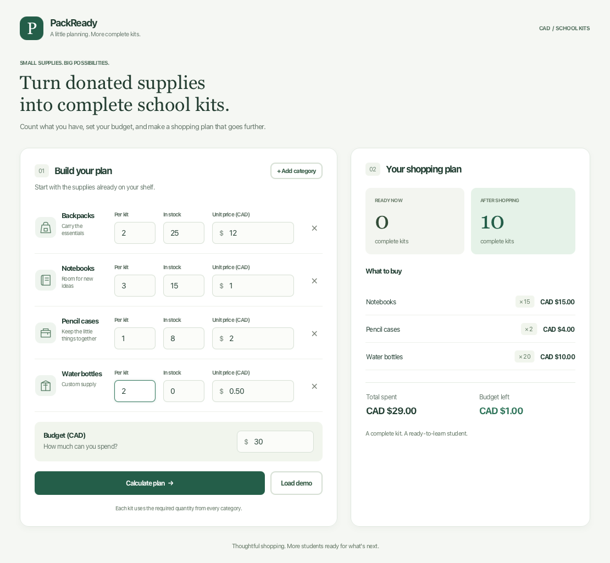

# HackDecouvertePlsWork

PackReady helps donation-drive volunteers decide what to buy to complete the
most school kits within a budget. The JavaFX application now includes editable
supply categories with per-kit quantities, Calculate, a randomized Load demo,
validation feedback, and a shopping-plan
panel. The layout uses two columns on a laptop and stacks on smaller windows.



## Open the app from VS Code

From this repository's root, with JDK 17 or newer on your terminal's path:

```sh
sh scripts/run-packready.sh
```

The launcher compiles the JavaFX application and opens its window. It uses the
same JavaFX 21.0.6 libraries as the Gradle project, reusing a local Maven cache
or downloading the platform-specific jars from Maven Central on first use.
Dependencies and compiled classes are cached under `/tmp`, outside the repo.
The script supports macOS on Intel/Apple silicon, Linux on Intel/ARM64, and
Windows x64 with Git Bash. It has been exercised on this Mac with JDK 25.

In IntelliJ, open `demo/build.gradle.kts` and run the application's `run` task.
The existing Gradle toolchain setting requests JDK 23. The terminal launcher
above works independently of that Gradle setup.

Click **Load demo** to generate fresh values and immediately calculate a plan.
Each click randomizes the required quantities, stock, unit prices, and budget.
It restores the three example categories before filling them. Required quantities
range from 1 to 4, stock from 0 to 45, and budget from CAD $20 to $150. Prices are
positive amounts in 25-cent increments. Consecutive clicks always produce a
different dataset. Enter and Calculate use the same validation/calculation path.

## Required quantities and cost

Each row has a **Per kit** field: the positive whole number of that item needed
in one complete pack. It defaults to 1 and is included for custom categories too.
For example, 10 notebooks at 2 per pack can supply 5 complete packs.

For a target number of packs, the planner buys only missing units:

```text
kits ready now = smallest whole-number result of stock / required quantity
units to buy = max(0, target kits × required quantity - stock)
line cost = units to buy × unit price in cents
total spent = sum of the line costs
```

The planner searches for the greatest affordable kit count. It uses bounded
binary search so large quantities remain fast, checks affordability without
overflowing costs, and stores purchase quantities as `long`. Kit counts retain
the existing `int` limit. Money remains exact integer cents.

The original fixed acceptance example remains in the tests: set every Per kit
field to 1, stock to 25 / 15 / 8, prices to $12 / $1 / $2, and budget to $30.
That produces 8 kits now, 20 after shopping, $29 spent, and $1 left. A $32 budget
produces 21 kits. These fixed fixtures are separate from the randomized demo.

## Add and remove categories

- Click **+ Add category**, enter a unique name, and click **Add** or press Enter.
  The new row starts with zero stock; enter its positive unit price before
  calculating. Names can have up to 60 characters and duplicates ignore case.
- Click **×** beside a category to remove it from the kit recipe. **Undo** restores
  the most recently removed row, its position, and its entered values.
- Every selected category contributes its required quantity to each kit. Changes to
  the category list clear the old plan until you calculate again. At least one
  category is required to calculate.
- **Load demo** restores three categories with fresh random values and quantities.
  Category edits, like the other form values, last for this window's
  session; they are not saved across restarts.

For example, add Water bottles at 2 per kit, zero stock, and a $0.50 unit price
to the fixed $30 reference recipe above. It produces 15 kits, spends $29,
and leaves $1. Undo restores required quantities as well as stock and prices.

## Return to the previous UI

This update is isolated on `required-quantities`. The previous category editor
is preserved on `categories` and tag `ui-before-quantities` at `5d2b13b`.
The earlier original UI remains on `layout` and tag `ui-before-categories` at
`1e372a3`. No reset or deletion of new work is needed to go back.

Close the running window, then switch and reopen:

```sh
git switch categories
sh scripts/run-packready.sh
```

Use `git switch required-quantities` to return to this update. The saved tags let
us recover the exact previous versions even if their branches change later.

## Source layout

All production classes use `package org.example.demo;` in
`demo/src/main/java/org/example/demo`:

| Class | Purpose |
| --- | --- |
| `PackReadyInputs` | Parses stock, positive per-kit quantities, and exact integer cents. |
| `PackReadyForm` | Validates selected categories and budget, identifies the first invalid field, and supplies demo values. |
| `Planner` | The team's purchase planner and its `Item`, `Purchase`, and `Plan` records. |
| `PackReadyResults` | Formats the supplied plan in CAD and replaces the previous text result. |
| `PackReadyView` | Responsive supply form, labels, focus styles, and validation feedback. |
| `PackReadyController` | Calculate/Enter/demo actions, validation, and the planner call. |
| `PackReadyDemo` | Generates fresh valid demo values, independently of fixed test fixtures. |
| `PackReadyResultsPane` | Kit-count cards, purchase rows, and CAD totals. |

The stylesheet is `demo/src/main/resources/org/example/demo/packready.css`.
`HelloApplication` opens this view through the existing JavaFX launcher.

Standalone checks live in `demo/src/test/java/org/example/demo`. The validation
classes have been moved out of the default package so the JavaFX controller can
call them directly.

## Run the Java checks

From the repository root, with JDK 17 or newer on the terminal's path:

```sh
sh scripts/test-packready.sh
```

This compiles with warnings treated as errors and runs the parser, form,
planner, results, and combined-flow checks. The checks use core Java and need
no JavaFX toolkit or external test library. The script reports the temporary
directory containing the compiled classes; it writes no classes into the repo.

The parser, form, results, flow, category, quantity, and demo suites have 220
checks in total. The planner suite also includes its existing comparison with
2,000 generated cases. New checks compare 1,000 weighted recipes with exhaustive
search and validate 500 randomized demo datasets. The
combined-flow checks pass raw form text through validation, adaptation to
`Planner.Item`, the actual planner, and the results setter. They cover $0, $30,
$31.99, $32, zero stock, and exact decimal prices.

These checks have standalone `main` methods. Run the script to execute them;
the existing Gradle `test` task uses JUnit discovery instead.

## Run the JavaFX checks

```sh
sh scripts/test-packready-ui.sh
```

This opens a test window briefly, runs 133 checks, saves screenshots under
`/tmp/packready-ui-shots`, and closes the window. It checks the $30/$32/$0 plans,
the Enter action, demo loading, zero stock, invalid/blank input, field focus,
accessible field errors, stale-result clearing, and layouts down to 420px wide.
It also exercises category addition, duplicate names, deletion, Undo with the
original values, empty/single-category kits, and demo reset after editing.
It verifies quantity validation and focus, weighted purchase costs, quantity
preservation through Undo, repeated random demo clicks, and per-kit controls at
the 420px minimum width.
Desktop, stacked, error, and minimum-width screenshots have been inspected.

## How the controller connects the Java code

`PackReadyController` collects the active rows and budget, validates them with
`PackReadyForm`, adapts the items, and calls the planner. Its Java data flow is:

```java
PackReadyForm.Request request = PackReadyForm.parseCategories(
        view.categoryInputs(), view.fields().get(PackReadyForm.BUDGET).getText());
List<Planner.Item> items = new ArrayList<>();
for (PackReadyForm.Item item : request.getItems()) {
    items.add(new Planner.Item(item.getName(), item.getStock(), item.getUnitPriceCents(), item.getRequiredQuantity()));
}
Planner.Plan plan = Planner.planPurchase(items, request.getBudgetCents());
view.results().showPlan(plan);
```

The validated `int` cents widen exactly to the planner's `long` cents.
The JavaFX results panel uses the shared `PackReadyResults.formatCad` formatter;
`PackReadyResults.format` also supplies its accessible summary.

The controller catches `PackReadyForm.FieldValidationException`, displays the
specific error, clears stale results, and focuses the field identified by
`getFieldName()`. The error is also associated with that field's accessible help.
On smaller windows it scrolls the invalid field into view. Load demo obtains
fresh values from `PackReadyDemo`, fills the fields, and calls the same
calculation path as Calculate and the text fields' Enter actions.
`PackReadyForm.demoFields()` remains the fixed one-per-kit reference fixture.
The map-based form parser also accepts optional `backpack-required`,
`notebook-required`, and `pencil-case-required` keys; omitted keys default to 1
for legacy callers. The original `Planner.Item` constructor also defaults to 1.

## Review notes and original history

- [Original app notes](docs/packready-app-notes.md) preserve the validation
  walkthrough and handoff review.
- [Original results notes](docs/packready-results-notes.md) preserve the results
  walkthrough and test evidence.
- The original branches and full commit history are preserved as
  `archive/packready-app` and `archive/packready-results`.

The source history is from `wazz64/HackDecouvert2026WWYJ`. The combined transfer
is preserved on `packready-transfer`; the original JavaFX UI is on `layout` and
the category editor is on `categories`.
The required quantities and random demo update is on `required-quantities`.

The earlier maximum-stock overflow described in the historical
[planner boundary notes](docs/packready-results-notes.md#planner-boundary-follow-up)
is fixed on this branch: the bounded search never increments beyond the largest
representable kit count. Regression checks cover that case, large required
quantities, large purchase-unit counts, and unaffordable costs exceeding `long`.
